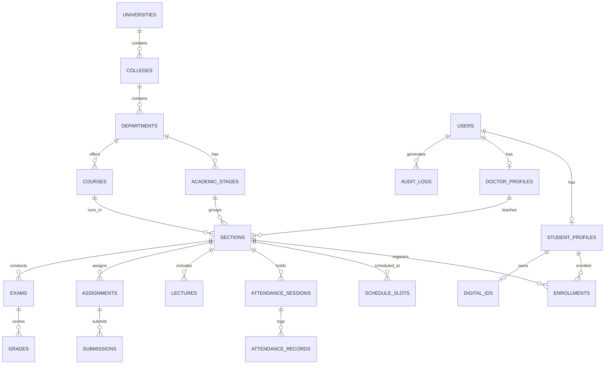
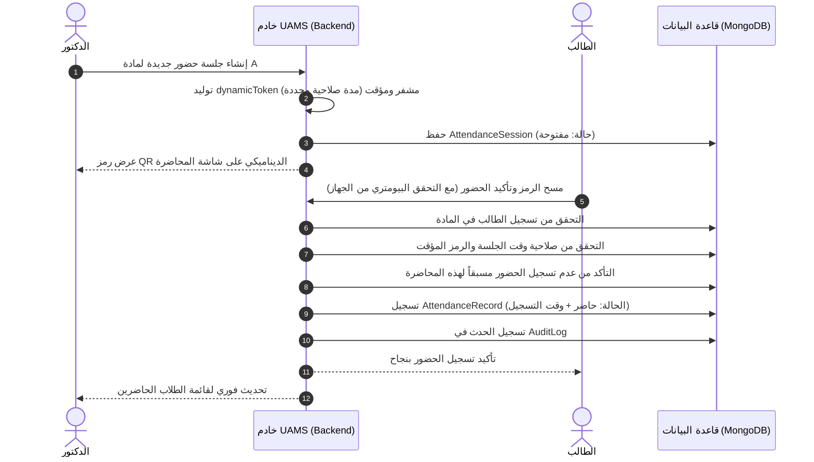

# وثيقة المعمارية وخطة التنفيذ
## نظام الإدارة الجامعية الذكي (UAMS - University Academic Management System)

---

## 1. نظرة عامة على المعمارية (System Architecture)

يعتمد النظام على **معمارية طبقية نظيفة (Clean Layered Architecture)** تضمن الفصل التام بين واجهة المستخدم، مسارات الـ API، منطق الأعمال، وطبقة البيانات، مع الالتزام بمبدأ التحقق المركزي في الخادم لجميع الصلاحيات.

```mermaid
flowchart TD
    subgraph Clients["طبقة العملاء (Client Layer)"]
        WebAdmin["لوحة الإدارة (Web Dashboard)"]
        WebDoctor["بوابة الدكتور (Doctor Portal)"]
        MobileStudent["تطبيق الطالب / الهوية الرقمية (Student App)"]
    end

    subgraph SecurityGate["بوابة الأمان والتحكم (Security & Middleware)"]
        HelmetCors["Helmet & CORS Security"]
        RateLimiter["Rate Limiter (Anti-Brute Force)"]
        AuthJWT["JWT Auth & Session Manager"]
        RBAC["Role & Permission Guard (Least Privilege)"]
        AuditInterceptor["Audit Log Interceptor"]
    end

    subgraph AppLogic["منطق الأعمال والخدمات (Services Layer)"]
        AuthService["Auth & Security Service"]
        AcademicService["Academic & Schedule Service"]
        AttendanceService["Smart Dynamic QR Attendance Engine"]
        GradingService["Exams, Grades & Dynamic GPA Engine"]
        AssignmentService["Assignments & Submissions Service"]
        DigitalIdService["Digital Student ID & Verification Engine"]
        FileService["Protected File & PDF Annotation Service"]
        ReportService["Analytics & Excel/PDF Export Engine"]
    end

    subgraph DataStorage["طبقة البيانات والتخزين (Persistence Layer)"]
        MongoDB[("MongoDB Database\n(Mongoose ODM - NoSQL Relational)")]
        SecureStorage[("Secure File Storage\n(Protected Course Uploads)")]
    end

    Clients --> SecurityGate
    SecurityGate --> AppLogic
    AppLogic --> DataStorage
```



---

## 2. هيكل البيانات في NoSQL (MongoDB / Mongoose Schema Design)

على الرغم من استخدام **MongoDB (NoSQL)**، إلا أن بيانات النظام ذات طبيعة أكاديمية مترابطة؛ لذا تم تصميم النماذج وفق أسلوب **Hybrid Relational-Document Pattern** (الاعتماد على المعرّفات المرجعية `ObjectId References` للكيانات الرسمية لمنع تكرار البيانات، مع استخدام الكائنات المدمجة `Embedded Subdocuments` للبيانات التابعة مثل الملاحظات الشخصية، سجلات الجلسات، وعناصر التقدم).



### تفاصيل النماذج الرئيسية (Core Models):

1. **`User`**: الحساب الأساسي الجامعي (البريد الرسمي، كلمة المرور المشفرة بـ Bcrypt، الدور `role: [ADMIN, DOCTOR, STUDENT]`، حالة الحساب `status: [ACTIVE, SUSPENDED, EXPIRED, SOFT_DELETED, PENDING]`، إعدادات الدخول البيومتري، والجلسات النشطة).
2. **`StudentProfile`**: الرقم الجامعي، الكلية، القسم، المرحلة، الشعبة، المعدل التراكمي (GPA)، الحالة الدراسية، والحد الأقصى للغياب.
3. **`DoctorProfile`**: الرقم الوظيفي، الدرجة الأكاديمية، القسم، والكلية.
4. **`Course` & `Section`**: المادة، الرمز الأكاديمي، عدد الساعات، الشعبة، الدكتور المشرف، والقاعة.
5. **`ScheduleSlot`**: أوقات المحاضرات الأسبوعية (اليوم، وقت البدء، وقت الانتهاء، القاعة، المبنى).
6. **`AttendanceSession`**: جلسة الحضور التي ينشئها الدكتور، تحتوي على رمز الجلسة، رمز `QR` الديناميكي المشفر (`dynamicToken`)، تاريخ ووقت البدء والانتهاء، والحالة (`OPEN`, `CLOSED`).
7. **`AttendanceRecord`**: تسجيل حضور الطالب في الجلسة، نوع الحضور (`PRESENT`, `ABSENT`, `LATE`)، وقت التسجيل الدقيق، التحقق البيومتري، وسجل التعديل اليدوي إن وُجد.
8. **`Assignment` & `Submission`**: الواجب، الموعد النهائي، ملفات التكليف، حالة تسليم الطالب (`NEW`, `PENDING`, `SUBMITTED`, `LATE`, `GRADED`)، الدرجة، وملاحظات الدكتور.
9. **`Exam` & `Grade`**: الامتحانات (Quiz, Midterm, Final, Practical)، ونظام توزيع الدرجات، ورصد النتائج.
10. **`CourseMaterial` & `StudentAnnotation`**: ملفات المحاضرات بصيغة PDF مع إتاحة حفظ تظليلات وملاحظات الطالب الشخصية كـ Subdocuments معزولة.
11. **`DigitalId`**: بيانات البطاقة الجامعية الرقمية، الرمز المشفر `QR` للتحقق السطحي الآمن.
12. **`AuditLog`**: التوثيق غير القابل للحذف لكل العمليات الحساسة (المستخدم، الفعل، التاريخ والوقت، عنوان IP، والعنصر المتأثر).

---

## 3. دورة حياة الحضور الذكي برمز QR الديناميكي (Smart QR Flow)



---

## 4. هيكل مجلدات المشروع (Directory Structure)

```text
uams/
├── config/
│   ├── db.js                 # الاتصال بقاعدة بيانات MongoDB
│   └── constants.js          # الثوابت، الأدوار، وحالات النظام
├── controllers/              # وحدات التحكم بالطلبات (Request Handling)
│   ├── authController.js
│   ├── adminController.js
│   ├── doctorController.js
│   ├── studentController.js
│   ├── attendanceController.js
│   ├── courseController.js
│   ├── assignmentController.js
│   └── reportController.js
├── models/                   # نماذج بيانات Mongoose
│   ├── User.js
│   ├── StudentProfile.js
│   ├── DoctorProfile.js
│   ├── Department.js
│   ├── Course.js
│   ├── Section.js
│   ├── AttendanceSession.js
│   ├── AttendanceRecord.js
│   ├── Assignment.js
│   ├── Submission.js
│   ├── Exam.js
│   ├── Grade.js
│   ├── DigitalId.js
│   ├── Notification.js
│   └── AuditLog.js
├── middlewares/              # البرمجيات الوسيطة
│   ├── authMiddleware.js     # التحقق من توكن JWT والجلسة
│   ├── roleMiddleware.js     # التحقق من الصلاحيات (Admin, Doctor, Student)
│   ├── auditMiddleware.js    # تسجيل العمليات الحساسة تلقائياً
│   ├── uploadMiddleware.js   # رفع وفحص الملفات بـ Multer
│   └── errorMiddleware.js    # المعالجة المركزية للأخطاء
├── routes/                   # مسارات الـ API الموثقة
│   ├── authRoutes.js
│   ├── adminRoutes.js
│   ├── doctorRoutes.js
│   ├── studentRoutes.js
│   ├── attendanceRoutes.js
│   └── courseRoutes.js
├── services/                 # منطق الأعمال (Business Logic & Calculations)
│   ├── qrService.js          # توليد وفك تشفير رموز الحضور والهوية
│   ├── gpaService.js         # حساب المعدل التراكمي وتوزيع النسب
│   └── exportService.js      # تصدير تقارير Excel و PDF
├── uploads/                  # مجلد التخزين الآمن للملفات والمرفقات
├── seeders/                  # بيانات تجريبية متكاملة للعرض والمناقشة
│   └── demoDataSeeder.js
├── .env.example
├── server.js                 # نقطة الدخول الرئيسية للخادم
└── package.json
```

---

## 5. خطة التنفيذ على مراحل (Phased Roadmap)

| المرحلة | المهام الأساسية | المخرجات |
| :--- | :--- | :--- |
| **المرحلة 1: البنية التحتية ونماذج البيانات** | - ربط MongoDB وإنشاء ملفات البيئة `.env`<br>- بناء جميع نماذج Mongoose الـ 15 مع العلاقات الصارمة والـ Indexes<br>- تجهيز نظام الاستجابة الموحد والمعالجة المركزية للأخطاء | قاعدة بيانات جاهزة وهيكل ملفات متين. |
| **المرحلة 2: نظام المصادقة والصلاحيات (Auth & RBAC)** | - تسجيل الدخول الآمن، تجديد الجلسات، وإلغاء الجلسات<br>- منع إنشاء الحسابات الذاتية وتخصيص إنشائها للإدارة فقط<br>- تفعيل سجل التدقيق `AuditLog` لأي عملية دخول أو تغيير صلاحيات | حماية شاملة للواجهات البرمجية وتصنيف الأدوار. |
| **المرحلة 3: الهيكل الأكاديمي وإدارة المواد** | - بناء CRUD الكليات، الأقسام، المراحل، والشعب<br>- نظام التسجيل في المواد (`Enrollments`) والجدول الدراسي الأسبوعي<br>- دعم فلترة الجداول حسب اليوم المختار | بيئة أكاديمية كاملة تربط الطالب والمادة والدكتور. |
| **المرحلة 4: الحضور الذكي بـ QR والهوية الرقمية** | - محرك توليد وفحص الـ QR الديناميكي المؤقت<br>- التحقق من الحضور متعدد الطبقات (وقت، تسجيل، تكرار)<br>- كارت الهوية الجامعية الرقمية مع رمز التحقق المشفر | نظام حضور آمن معتمد رقمياً وبطاقة هوية ذكية. |
| **المرحلة 5: الواجبات والامتحانات والدرجات والمعدل** | - دورة الواجبات الكاملة (تكليف، تسليم، تصحيح، ملاحظات)<br>- إدارة الامتحانات (Quiz, Midterm, Final)<br>- محرك الدرجات المرن وحساب الـ GPA وفق سياسة الجامعة | إدارة درجات وتقييم أكاديمي متكامل. |
| **المرحلة 6: إدارة المحاضرات والملفات والـ PDF** | - رفع المحاضرات ومشاركتها<br>- نظام إضافة الملاحظات والتظليلات الشخصية للطالب على ملفات الـ PDF | مكتبة تعليمية ومستودع ملفات آمن. |
| **المرحلة 7: الإشعارات والتقارير وتصدير Excel** | - مركز إشعارات داخلي تفاعلي مرتبط بالأحداث الأكاديمية<br>- تصدير كشوفات الحضور وسجلات الدرجات إلى ملفات Excel عبر `exceljs` | نظام تقارير وإحصائيات للإدارة والدكتور. |
| **المرحلة 8: البيانات التجريبية وملف المناقشة (Defense Kit)** | - سكريبت بذر البيانات التجريبية `demoDataSeeder` (حسابات تجريبية واقعية جاهزة للطلاب والدكاترة والإدارة)<br>- توثيق الـ APIs ودليل تشغيل النظام أمام لجنة التحكيم | نظام كامل جاهز للعرض والمناقشة والإنتاج. |
